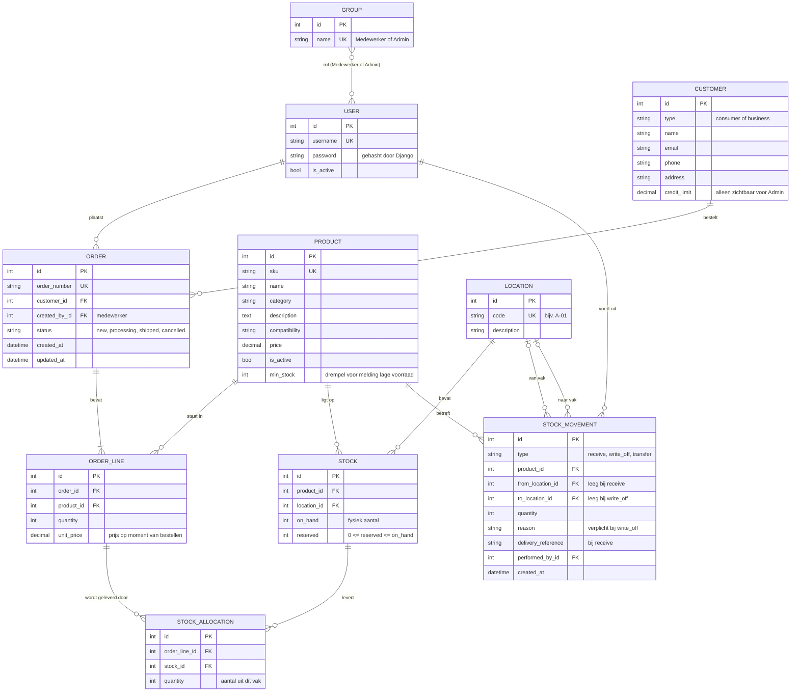

# ERD PixelDepot WMS

Eerste versie, week 1 · Kien (review: Daniel)

Gebaseerd op het hoofdstuk *Datamodel en voorraadregels* uit het projectplan. Elke tabel heeft een automatische `id` als primaire sleutel (PK). `FK` is een verwijzing naar een andere tabel, `UK` een unieke waarde.

## Unieke combinaties en constraints

| Tabel | Regel | Waarom |
| --- | --- | --- |
| Product | `sku` uniek | Een dubbele SKU geeft een duidelijke fout (US-04) |
| Location | `code` uniek | Elk vak bestaat één keer |
| Stock | (`product`, `location`) uniek | Eén voorraadrij per product per vak |
| Stock | `0 ≤ reserved ≤ on_hand` | Nooit meer reserveren dan er fysiek ligt |
| Order | `order_number` uniek | Zoeken op ordernummer (US-06) |
| OrderLine | (`order`, `product`) uniek | Eén orderregel per product |
| StockAllocation | (`order_line`, `stock`) uniek | Eén toewijzing per orderregel en vak |

## Keuzes

- **Beschikbaar** is geen kolom: `on_hand − reserved` wordt berekend, zodat het nooit uit de pas loopt.
- **Rol** loopt via Django-groepen in plaats van een eigen kolom, zodat Django's rechtensysteem meteen werkt.
- **Orders** hebben geen verwijderactie; annuleren zet `status` op `cancelled`.
- **Geld** (`price`, `unit_price`, `credit_limit`) is decimaal. Een orderregel bewaart zijn eigen prijs, zodat een prijswijziging oude orders niet verandert.
- **StockMovement** heeft twee optionele vakken: `receive` vult alleen `to`, `write_off` alleen `from`, `transfer` allebei.
