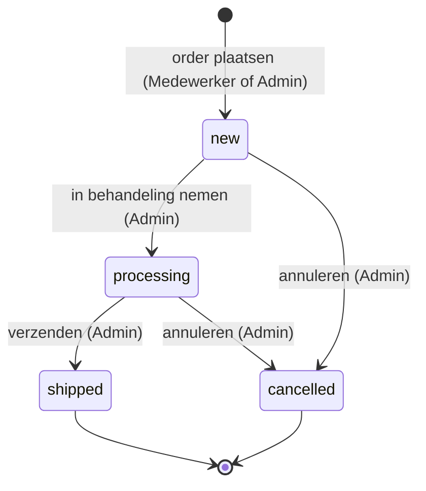

# Orderstatussen PixelDepot WMS

Eerste versie, week 1 · Kien (review: Daniel)

Gebaseerd op *Orderstatussen* en *Wat Django doet per actie* uit het projectplan. De waarden in de database zijn Engels, het scherm toont het Nederlandse label.

| Waarde | Label | Order aanpassen | Eindstatus |
| --- | --- | --- | --- |
| `new` | Nieuw | Ja | Nee |
| `processing` | In verwerking | Ja | Nee |
| `shipped` | Verzonden | Nee | Ja |
| `cancelled` | Geannuleerd | Nee | Ja |

## Overgangen en voorraad

Elke overgang loopt via `OrderService` in één `transaction.atomic()`. Django weigert elke overgang die niet in deze tabel staat met `400`.

| Overgang | Wie | Wat er met de voorraad gebeurt |
| --- | --- | --- |
| → `new` | Medewerker, Admin | `reserved` omhoog per vak via StockAllocations. Te weinig van één product: hele order geweigerd met `409`, niets opgeslagen. |
| `new` → `processing` | Admin | Niets. |
| `processing` → `shipped` | Admin | Per allocatie `on_hand` én `reserved` omlaag. Beschikbaar blijft gelijk. |
| `new` / `processing` → `cancelled` | Admin | Per allocatie `reserved` omlaag, op het oorspronkelijke vak. `on_hand` blijft gelijk. |
| Aanpassen in `new` / `processing` | Admin | Verschil bijreserveren of vrijgeven. Alleen opslaan als alle regels haalbaar zijn, anders `409`. |

## Regels

- **Eenmalig.** Verzenden en annuleren kijken eerst naar de huidige status, na `select_for_update()` op de orderrij. Een tweede annulering of verzending verandert daardoor niets.
- **Allocaties blijven bewaard.** Na verzenden en annuleren blijven de StockAllocations staan als historie: welk vak leverde hoeveel. De status bepaalt of ze nog als reservering tellen.
- **Nooit verwijderen.** Een order wordt nooit verwijderd; annuleren is de administratieve handeling.
- **Geen terugweg.** `shipped` en `cancelled` hebben geen uitgaande overgang. Een vergissing herstel je met een nieuwe order of een ontvangst.
- **Rechten.** Een medewerker die via de API de status wijzigt, krijgt `403`.

## Voorbeeld: headset op vak A-01, order van 3

| Moment | Status | on_hand | reserved | Beschikbaar |
| --- | --- | --- | --- | --- |
| Start | – | 10 | 0 | 10 |
| Geplaatst | `new` | 10 | 3 | 7 |
| In behandeling | `processing` | 10 | 3 | 7 |
| Verzonden | `shipped` | 7 | 0 | 7 |
| *Of:* geannuleerd | `cancelled` | 10 | 0 | 10 |
| Nogmaals geannuleerd | `cancelled` | 10 | 0 | 10 |
